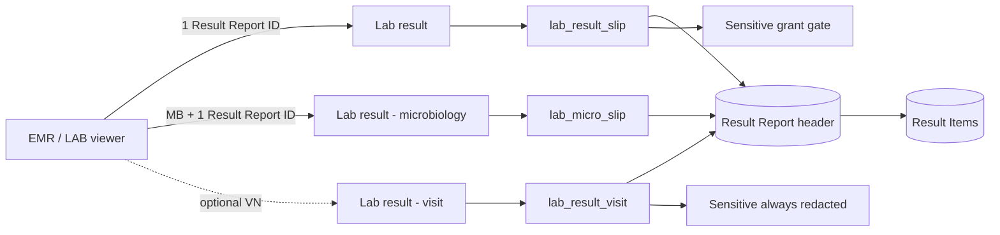

# LAB Result Report Factory — Live Handoff

สถานะ: **ตรวจ live แบบ read-only และผ่าน runtime UAT ต่อ Order แล้ว 2026-10-28**

กลุ่มเป้าหมาย: นักพัฒนา/ทีม Report Factory ที่เพิ่งรับงานต่อ

ขอบเขต: รายงาน **ผลตรวจ LAB** เท่านั้น ไม่รวมใบสั่งตรวจ, sticker, Blood Bank bag label หรือ X-Ray report

## 1. สรุปสำหรับคนรับงานต่อ

ระบบมี Report ผล LAB สด 3 ตัว:

| ระดับ | Report Factory | SQL Factory | Parameter | ใช้อยู่ตรงไหน |
|---|---|---|---|---|
| ผล 1 Result Report — ห้องทั่วไป | `6aa8f5a8b92813319a86ea11` · `Lab result` | `6ab0a1c4d0c3ef2e97911e55` · `lab_result_slip` | `xparentx` = canonical Result Report ID; `grant_token` ส่งเพิ่มจาก caller ได้แต่ไม่แสดงใน Report Parameters | ปุ่ม PDF ต่อ Order/ใบ สำหรับ `BC, HM, HH, ML, IM, MI-OUT, MY, BB, BG` |
| ผล 1 Result Report — Microbiology | `6ab1c2d3e4f5061728394a5b` · `Lab result - microbiology` | `6ac2f1a0d0c3ef2e97912a01` · `lab_micro_slip` | `xparentx` = canonical Result Report ID | ปุ่ม PDF ต่อ Order/ใบ เฉพาะ `MB` |
| ผลทุกห้องใน 1 Visit | `6adb696c41ac687aac3f3cc2` · `Lab result - visit` | `6adb696c41ac687aac3f3cc0` · `lab_result_visit` | `vn` | มี live แล้ว แต่ **ยังไม่ใช่ปุ่ม PDF ต่อ Order ที่ยืนยันใน EMR path ปัจจุบัน** |

ทั้งสามเป็น `pdf_type=report`, A4 portrait, THSarabun base size 12, margin `[36, 8, 36, 40]` และ `pdf_share=public`. `public` ไม่ใช่หลักประกันว่าผลลับปลอดภัย; การปกปิดต้องเกิดใน provider ฝั่ง server ก่อนข้อมูลถึง Report renderer.



## 2. หลักการ key ที่ห้ามสับสน

- Caller ต้องส่ง **canonical Result Report ID** ไม่ใช่ Order ID, CPOE Item ID, LAB NO. หรือ HN.
- Live `lab_result_slip` และ `lab_micro_slip` เริ่มจาก:
  `zdata_lab_report_manual_entry.xparentx = ObjectId({{xparentx}})` และ `xrstatx = 1`.
- Read-only sampling วันที่ 2026-10-28 ยืนยันว่า Result Report รุ่นปัจจุบันเก็บ
  `_id == xparentx == result_report_id`; จึงส่ง `result_report_id` ได้ แต่ SQL match ที่ field
  `xparentx` จริง. อย่าเปลี่ยน contract เป็น Order ID.
- Standard Result Item ถูกเลือกเมื่อ `xrstatx=1` และ parent ตรง `report.xparentx`;
  Microbiology ใช้ `report._id`. Live canonical ทำให้สองค่านี้เท่ากัน แต่ทีมต้องรักษาความต่างของ
  pipeline เดิมจนกว่าจะมี migration contract ที่ยืนยันแล้ว.
- ก่อนเปิด PDF ต่อ Order ต้อง resolve ได้ Result Report ID ที่ถูกต้อง **exactly 1 ค่า**.
  ศูนย์ค่า = ปิดปุ่ม/แจ้งว่ายังไม่มีผล; มากกว่า 1 ค่า = ห้ามเดาเลือกบางชุด.
- Adapter/UI ต้องตรวจ ID เป็น ObjectId string 24 hex ก่อนส่งเข้า Report Factory.

## 3. Report Factory binding

Report Factory ดึง rows จาก `pdf_sql`; `{{field}}` ใน `pdf_content` และ `pdf_column` ต้องตรงชื่อ output ของ provider. `content_var` เป็นเพียงชื่อใน Builder ไม่ได้ bind runtime.

### 3.1 `Lab result`

- Report ID: `6aa8f5a8b92813319a86ea11`
- SQL: `6ab0a1c4d0c3ef2e97911e55` · `lab_result_slip`
- Body widgets: letterhead → patient/header → rule → title → result header → table → footer.
- Header bindings:
  `clinic`, `collected`, `dob`, `hn`, `lab_section_line`, `lno`, `order_date`,
  `patient_name`, `printed`.
- Dynamic result header: `result_cols`, `head_site_cell`.
- Table row bindings:
  `test_name`, `site_cell`, `result_unit`, `interpretation`, `ref_range`, `comment_row`.
- Footer bindings:
  `reported`, `reported_by`, `reported_lic`, `approved_by`, `approve_lic`,
  `approve_date`, `order_note_block`.
- `pdf_column` มี 1 HTML column; provider สร้าง HTML row เอง. ไม่มี JS expression.

### 3.2 `Lab result - microbiology`

- Report ID: `6ab1c2d3e4f5061728394a5b`
- SQL: `6ac2f1a0d0c3ef2e97912a01` · `lab_micro_slip`
- ใช้ HTML widgets ทั้งหมด; ไม่มี `pdf_column` table.
- Bindings:
  `lab_section_name`, `section_detail`, `hn`, `patient_name`, `age`, `sex`, `ward`,
  `lno`, `specimen`, `collected`, `received`, `reported`, `reported_by`, `approved_by`,
  `culture_rows`, `abx_html`, `lab_no`, `printed`, `page_no`, `mlab_version`.
- เหตุที่แยก Report: ผล MB เป็น narrative/culture slip และ provider parse ข้อความเป็น
  culture rows + antibiogram ไม่ใช่ตาราง analyte มาตรฐาน.

### 3.3 `Lab result - visit`

- Report ID: `6adb696c41ac687aac3f3cc2`
- SQL: `6adb696c41ac687aac3f3cc0` · `lab_result_visit`
- Header bindings: `vn`, `hn`, `patient_name`, `dob`, `printed`.
- Table row bindings:
  `sec_head`, `test_name`, `site_cell`, `result_unit`, `interpretation`, `ref_range`,
  `comment_row`.
- `sec_head` แสดงหัวห้องเมื่อเริ่ม Result Report ชุดใหม่.
- รายงานนี้รวม Result Report ทุกห้องที่ `visit_id == vn`, มี Result Item จริง และ active.

## 4. SQL Factory providers

ทั้งสาม record เป็น `sql_type=nosql` และใช้ `nosql_pipeline` (MongoDB aggregation JSON) ไม่ใช่ SQL text. แก้ syntax ต้องแก้ pipeline JSON และรักษา parameter placeholder แบบ `{{name}}`.

### 4.1 `lab_result_slip`

Base collection: `zdata_lab_report_manual_entry`
Initial condition:

```text
xparentx == ObjectId(trim({{xparentx}}))
AND xrstatx == 1
```

Lookup/field sources:

| Collection | Join/condition | Fields ที่ใช้ |
|---|---|---|
| `zdata_visit` | `visit.vn == report.visit_id`, first row | `xparentx`, `ward` |
| `zdata_person` | `_id == visit.xparentx`, first row | `prename`, `p_fname`, `p_lname`, `age`, `p_gender`, `birth_date` |
| `zdata_organization` | `unit_type='lab'` และ `report.lab_section` อยู่ใน comma-separated `unit_initial_en` | `unit_name`, `floor`, `loc` |
| `zdata_section` | `code == report.lab_section` | `name`, `name_th`, `unit.value` |
| `zdata_cpoe_order_item` | `_id == order_status_id`; fallback `_id == order_no` | `order_id.value`; สำหรับแต่ละ Result Item ใช้ `item_data_id`, `order_id.value` |
| `zdata_cpoe_order` | `_id == CPOE Item.order_id.value`; fallback `_id == report.order_no` | `created_at`, `order_clinic`, `order_number` |
| `core_user` | หา reporter/verifier ด้วย `_id`, `username`, `profile.person_code` หรือ `profile.provider_code` | ชื่อ, ตำแหน่ง, `certificate_code` |
| `zdata_lab_result_item` | active และ parent ตรง Result Report; sort numeric `result_sequence`, `_id` | ชื่อผล, ค่า, หน่วย, interpretation, ref range, comment, site, parent order |
| `zdata_master_item_order` | `_id == CPOE Item.item_data_id` | `is_hide_result` |
| `zdata_emr_sensitive_access_grant` | token + parent Order + section ตรง, ยังไม่หมดอายุ, active | grant existence เท่านั้น |

Output fields:

```text
_id, hn, patient_name, age, sex, ward, lno, specimen, collected,
received, reported, reported_by, approved_by,
lab_section_name, lab_section_no, lab_section_name_th, lab_section_line,
section_detail, printed, order_date, approve_date,
reported_lic, approve_lic, dob, clinic,
test_name, result_value, unit, result_unit, interpretation, ref_range,
comment_row, sensitive_redacted, site,
result_cols, head_site_cell, site_cell, order_note_block
```

Important derivations:

- `test_name` = `result_item.test_name`, fallback `obs_name`.
- `result_unit` = value + unit; unit fallback `unit_symbol_snapshot`.
- `ref_range` fallback `reference_range_snapshot`.
- `site` = `actual_site_name`, fallback `ordered_site_name_snapshot`; เมื่อมี site อย่างน้อยหนึ่งแถว provider เปลี่ยน layout เป็น 5 คอลัมน์.
- `comment_row` แปลง newline เป็น `<br>` และซ่อนเมื่อผลถูก redact.
- `order_note_block` มาจาก Result Report `order_note` และ escape HTML ก่อน render.
- `specimen` และ `collected` ของ provider live ปัจจุบันไม่มี source จริงและจบเป็น `-`.

#### Sensitive gate ของ `lab_result_slip`

1. หา CPOE Item จาก `result_item.order_no`.
2. หา Order Master จาก `cpoe_order_item.item_data_id`.
3. ถ้า `master.is_hide_result == true`, ต้องมี grant ที่:
   - `grant_token` ตรง parameter;
   - `source_order_id` ตรง `cpoe_order_item.order_id.value`;
   - `section_code` ตรง Result Report `lab_section`;
   - `expires_at_epoch >= now`;
   - `xrstatx == 1`.
4. ถ้าไม่มี grant ที่ครบทุกข้อ ให้ยังแสดงชื่อรายการ แต่แทนผลด้วย `ปกปิดผล` และปิดหน่วย,
   interpretation, ref range และ comment.

Report record แสดง parameter `xparentx` เพียงตัวเดียว แต่ SQL ยังรับ `grant_token` แบบ optional
จาก caller. Screen grant กับ PDF grant เป็นคนละ scope; ห้ามส่งต่ออัตโนมัติ.

### 4.2 `lab_micro_slip`

Base collection และ initial condition เหมือน `lab_result_slip` แต่ไม่มี Sensitive grant lookup.
Header joins ใช้ Visit, Person, Organization, Section, CPOE Order/Item และ core_user แบบเดียวกัน.

Result Item lookup:

```text
xrstatx == 1
AND (toString(item.xparentx) == toString(report._id)
     OR toString(item.result_report_id) == toString(report._id))
ORDER BY numeric(result_sequence), _id
PROJECT result_value only
```

Provider ใช้ `result_value` แถวแรกเป็น narrative source แล้ว parse ดังนี้:

- normalize CRLF/CR เป็น LF;
- เส้น `----------` ใช้แบ่ง body กับ antimicrobial section;
- segment ที่มี `Time To Positive` ถูกแยกเป็น `TTP`;
- `*...*` ใช้เป็น culture/type label;
- antimicrobial regex อ่านชื่อยาอักษรใหญ่และค่า `S/I/R/N` สูงสุด 3 ค่า;
- antibiogram จัดเป็น 3 ชุดคอลัมน์;
- `SPECIMEN:` / `RELEASED:` / `LAB NO.` / `Page No:` ถูก parse จาก narrative;
- `received` fallback จาก Result Report `received_at`; `reported` fallback `reported_at`;
- `collected` และ `mlab_version` ปัจจุบันเป็น `-`; MIC ไม่มี source แยก.

Output fields:

```text
_id, hn, patient_name, age, sex, ward, lno, specimen, collected,
received, reported, reported_by, approved_by, printed,
lab_section_name, section_detail, culture_rows, abx_html,
lab_no, page_no, mlab_version
```

ข้อความ format จาก LIS/Manual เปลี่ยนเพียงเล็กน้อยก็ทำให้ parser แยกผิดได้. ก่อนแก้ regex ต้องเก็บ
fixture แบบ sanitized ครบอย่างน้อย: no growth, organism + TTP, antibiogram หลายคอลัมน์,
partial narrative และข้อความที่ไม่มี delimiter.

### 4.3 `lab_result_visit`

Initial condition:

```text
visit_id == trim({{vn}})
AND xrstatx == 1
ORDER BY reported_at, lab_section, _id
```

ใช้ joins/field mapping เกือบเหมือน `lab_result_slip`, แต่:

- รวมหลาย Result Report ใน Visit เดียว;
- หลัง unwind ตัด header ที่ไม่มี Result Item (`_items._id` ต้องมี);
- เพิ่ม `_first` ต่อ Result Report แล้วสร้าง `sec_head`; จากนั้น unset `_first`;
- Result Item ยัง match ด้วย `xparentx` หรือ `result_report_id` และ sort ตาม sequence;
- ไม่รับ `grant_token`; live pipeline ส่ง requested token เป็นค่าว่าง จึง **redact Sensitive rows เสมอ**;
- ไม่ควรนำ Report นี้ไปแทนปุ่ม per-Order โดยอัตโนมัติ เพราะ scope เปลี่ยนจาก 1 ใบเป็นทั้ง Visit.

Output เหมือน standard provider เป็นหลัก และเพิ่ม `vn`, `sec_head`.

## 5. Routing ที่ UI/adapter ต้องรักษา

| Condition | Report |
|---|---|
| section `MB` และมี valid Result Report ID exactly 1 | `Lab result - microbiology` |
| section `BC/HM/HH/ML/IM/MI-OUT/MY/BB/BG` และมี valid Result Report ID exactly 1 | `Lab result` |
| ไม่มี Result Report ID | ปิด/ซ่อนปุ่มพร้อมเหตุผล |
| มีมากกว่า 1 Result Report ID | ปิดปุ่มและแจ้งว่ามีผลหลายชุด; ห้ามเลือกตัวแรก |
| ผู้ใช้เลือก “PDF ทั้ง Visit” โดยชัดเจน | `Lab result - visit` พร้อม `vn` |

`MICRO_SECTIONS` ปัจจุบันคือ `['MB']`; **MY ไม่ใช้ microbiology report**.

## 6. จะเปลี่ยนอะไร ต้องแก้ที่ไหน

| เป้าหมาย | Artifact ที่แก้ก่อน | ตรวจต่อ |
|---|---|---|
| เพิ่ม/แก้ field ที่ SQL คืน | SQL Factory provider | ชื่อ output ต้องตรง `{{field}}`; test Report Preview |
| เปลี่ยน layout, label, table width, footer | Report Factory record | ห้ามเปลี่ยน provider contract โดยไม่จำเป็น |
| เปลี่ยนห้องที่ใช้ standard/micro | UI/adapter routing | UAT ทุก 10 ห้อง; อย่า infer จากชื่อ display |
| เปลี่ยน parent/result selection | SQL provider + caller contract | ต้องคง Result Report scope; test legacy `result_report_id` fallback |
| เปลี่ยน Sensitive policy | server provider/gate + security tests | fail closed; ห้ามแก้เฉพาะ HTML |
| เปลี่ยน MB narrative parser | `lab_micro_slip` | เพิ่ม sanitized fixtures ก่อนแก้ regex |
| เพิ่ม PDF ทั้ง Visit | UI action ใหม่ที่แยกจาก per-Order | ระบุ scope ชัด, ยืนยัน Sensitive redaction |

ชุด local ที่เกี่ยวข้อง:

- `02-his/handoff/lab-result-pdf-profile-group-v4/` — replacement package ของ standard report;
  ยังไม่ได้แทน live และคง Sensitive gate.
- `02-his/handoff/lab-result-pdf-sensitive-v3/` — package/contract รุ่นก่อนสำหรับ Sensitive row gate.
- `Form-Builder/API/report_factory/builders/build_lab_result_profile_group_replace.js`
- `Form-Builder/API/report_factory/builders/patch_lab_result_slip_sensitive_gate.js`
- `Form-Builder/API/report_factory/builders/patch_lab_result_report_hide_grant_param.js`

## 7. Ownership และ live write gate

Read-only metadata วันที่ 2026-10-28:

| Artifact | Created By |
|---|---|
| `Lab result` + `lab_result_slip` | `Parinya Tumchay` |
| `Lab result - microbiology` + `lab_micro_slip` | `Parinya Tumchay` |
| `Lab result - visit` + `lab_result_visit` | `SuperAdmin InitAPI` |

ไม่มีตัวใดเป็น artifact ที่ authoritative owner คือผู้ใช้ปัจจุบัน. Codex/ทีมใหม่จึง **read-only โดย default**.
การ Save/Replace/Publish live ต้องผ่าน three-confirmation exception แยกต่อ artifact และต่อ action
ตาม `AGENTS.md`; authorization หนึ่งครั้งไม่ครอบคลุม SQL + Report พร้อมกัน.

แนวทางปกติคือ export ของ live, ทำ local user-owned replacement package, ตรวจ diff/test แล้วส่งให้
เจ้าของ artifact หรือผู้ใช้ apply เอง. ห้าม Clone แล้วสลับ ID เงียบ ๆ เพราะ caller hard-code Report IDs.

## 8. Known risks / gaps

1. Report และ SQL ทั้งสามตั้ง `public`; ต้องพึ่ง provider redaction + app permission ด้วย.
2. Live Report Parameters มี sample default ที่ไม่ว่าง. ค่าไม่ได้คัดลอกไว้ในเอกสารนี้เพื่อไม่เก็บ
   patient/test identifiers. ทีมควรพิจารณาล้าง default หรือบังคับ caller ส่ง parameter ทุกครั้ง.
3. Standard provider ยังไม่มี specimen/collected source จริง.
4. Micro provider parse printable narrative text; format drift จาก LIS ทำให้ output ผิดได้.
5. Micro provider ไม่มี Sensitive gate; ใช้เฉพาะ MB ตาม routing ปัจจุบัน.
6. Visit report ปิด Sensitive เสมอและยังไม่ใช่ current per-Order action.
7. `pdf_page_num=false`; ข้อความ page/MLAB ใน micro มาจาก provider/เนื้อหา ไม่ใช่ Report footer engine.
8. Runtime UAT ต่อ Order ผ่านแล้วตาม §10; รายงานระดับ Visit ยังไม่ได้ถูกเรียกจากปุ่มจริง เพราะไม่ใช่
   current per-Order action ที่ยืนยันใน LAB viewer.

## 9. Checklist ก่อนส่งการแก้ไข

1. Export live SQL และ Report record แยกไฟล์; เก็บ `_id` เดิมและ redact sample/patient data.
2. เปรียบเทียบ live export กับ package ที่จะใช้; ห้ามถือว่า v3/v4 local เท่ากับ live โดยอัตโนมัติ.
3. แก้ SQL provider ก่อนเมื่อ contract field เปลี่ยน; Report ใช้ชื่อ field เดิมหรือเปลี่ยนพร้อมกัน.
4. Static checks ที่มี:

```bash
node Form-Builder/API/report_factory/tests/test_lab_result_slip_sensitive_gate_patch.js
node Form-Builder/API/report_factory/tests/test_lab_result_report_hide_grant_param_patch.js
node Form-Builder/API/report_factory/tests/test_lab_result_profile_group_replace.js
```

5. Preview ด้วยข้อมูล UAT/synthetic: standard single test, profile + children, MY site, MB narrative,
   Sensitive no-grant/valid-grant/expired-grant และหลาย Result Report IDs.
6. ตรวจว่า Result Items จากคนละ Result Report ไม่ปนกัน.
7. ตรวจ 10 ห้อง: `BC, HM, HH, ML, IM, MI-OUT, MB, MY, BB, BG`.
8. Runtime ต่อ Order ผ่านจากปุ่มจริงใน LAB แล้วตาม §10 รวม no-grant Sensitive ใน UI/PDF และ
   console. หากทีมเปลี่ยน security/provider ให้เพิ่ม packet-level และ browser-cache forensic check.

## 10. Runtime UAT วันที่ 2026-10-28

- ทดสอบจากปุ่มจริงใน LAB viewer แบบ read-only ด้วยชุดข้อมูล UAT/synthetic; ไม่ Save, Replace,
  Publish หรือแก้ live Form/API/Report/SQL และไม่คัดลอกตัวระบุผู้ป่วย/สิ่งส่งตรวจลง repository.
- ทั้ง 10 ห้องเปิด Report Preview เป็น PDF สำเร็จ: `BC, HM, HH, ML, IM, MI-OUT, MB, MY, BB, BG`.
- `BC, HM, HH, ML, MY, BB, BG, IM, MI-OUT` route ไป standard `Lab result`; `MB` route ไป
  `Lab result - microbiology`. ตรวจภาพจริงของ standard และ MB แล้ว layout/ข้อมูลตามประเภทแสดงได้.
- No-grant Sensitive check ผ่านทั้ง `IM` และ `MI-OUT`: หน้าผลและ PDF แสดงชื่อรายการแต่แทนค่าด้วย
  `ปกปิดผล`; ไม่แสดงค่า, หน่วย, interpretation, reference range หรือ comment.
- ระหว่างรอบทดสอบไม่พบ browser console warning/error. การยืนยันนี้ครอบคลุม UI DOM, Report Preview,
  rendered PDF และ console; ไม่ได้ทำ packet-level หรือ browser-cache forensic inspection แยกต่างหาก.
- Report ระดับ Visit ไม่ได้ถูก invoke ในรอบนี้ เพราะ current LAB viewer ยืนยันเฉพาะ per-Order action;
  เมนู `Report` บนรายการเป็น export PDF/Excel ของรายการ ไม่ใช่ `Lab result - visit`.

## 11. Provenance และขอบเขตการยืนยัน

- Live read-only: `his.module_report`, `his.module_sql`, `his.zdata_lab_report_manual_entry`
  วันที่ 2026-10-28.
- Repository routing/contracts:
  `design/emr-history-lab-results-implementation-handoff.md` และ
  `02-his/handoff/emr-history-lab-xray-result-data-ui-handoff.md`.
- Report Factory runtime binding: active `report-factory` skill (`pdf_sql`, `{{field}}`, table rows).
- LAB requirement boundary: active `lab-che` skill; แยก Result Report, Result Item และ UI routing.
- ไม่มี patient name, HN, VN, Result value, grant token หรือ sample parameter ถูกคัดลอกลง handoff นี้.
